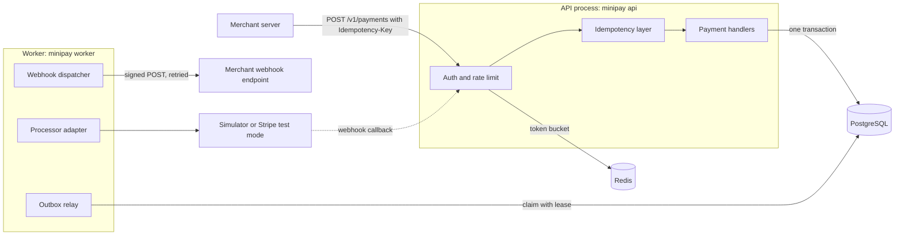

# MiniPay

A payments backend in Go demonstrating correctness under retries and races, double-entry accounting, reliable webhook delivery, and production engineering habits.

## Architecture



## Quickstart

```bash
# 1. Clone and enter the project
git clone https://github.com/Nishat30/Mini-Pay.git
cd Mini-Pay

# 2. Copy environment config
cp .env.example .env

# 3. Start dependencies (Postgres 16, Redis 7)
make up

# 4. Run migrations
make migrate

# 5. Start the API server
go run ./cmd/minipay api
```

## Stack

| Component | Choice | Justification |
|-----------|--------|---------------|
| Language | Go 1.25 | Concurrency, single binary, strong stdlib |
| Database | PostgreSQL 16 | ACID, deferred triggers, FOR UPDATE SKIP LOCKED |
| Cache | Redis 7 | Rate limiting only, behind interface |
| SQL | pgx v5 + sqlc + golang-migrate | Type-safe generated code from SQL |
| HTTP | net/http (Go 1.22+ routing) | No extra dependency needed |
| Logging | log/slog | Standard library structured logging |
| Testing | testcontainers-go, k6, toxiproxy | Real dependencies, load testing, fault injection |

See [ADR 0001](docs/adr/0001-stack-and-why.md) for the full rationale.

## Development

```bash
make up               # Start Postgres and Redis
make down             # Stop services
make test             # Unit tests with -race
make test-integration # Integration tests (needs running services)
make lint             # golangci-lint + go vet
make migrate          # Apply migrations
make build            # Build binary to bin/
```

## Project Status

- [x] Phase 0: Bootstrap — project scaffold, health checks, CI
- [x] Phase 1: Foundation — payments, single-transaction idempotency, double-entry ledger, outbox worker
- [x] Phase 2: Webhooks — SSRF defense (RFC 1918, link-local, cloud metadata), HMAC-SHA256 signatures, retry dispatcher
- [x] Phase 3: Refunds & Stripe Adapter — concurrency protection (`FOR UPDATE` + DB check constraint), ledger reversals, Stripe testmode adapter
- [x] Phase 4: Production Habits & Polish — token-bucket rate limiting (Redis + in-memory fallback), multi-tier risk engine (`amount_cap`, `velocity`), Prometheus metrics (`/metrics`), admin CLI review workflow & dashboard

## Admin Operations

```bash
# Check ledger invariants across all accounts
go run ./cmd/minipay admin check-ledger

# Create a new merchant
go run ./cmd/minipay admin create-merchant -name "Acme Corp"

# List payments awaiting risk review
go run ./cmd/minipay admin list-reviews

# Approve or decline a payment under review
go run ./cmd/minipay admin review-payment -id pay_01M... -action approve

# Inspect risk rule evaluation decisions
go run ./cmd/minipay admin inspect-risk -id pay_01M...

# Launch the administrative web dashboard (:8081)
go run ./cmd/minipay admin dashboard -port 8081
```

## Documentation

- [Architecture](docs/architecture.md) — Component diagrams, state machine, sequences
- [Code Map](docs/code-map.md) — Every file and its purpose
- [Work Log](docs/work-log.md) — What was built and why
- [Design Decisions](docs/adr/) — ADRs for every non-obvious choice
- [AI Usage Log](docs/ai-usage-log.md) — What was AI-generated and how it was verified

## Security

- API keys stored as SHA-256 hashes only
- Stripe live keys (`sk_live_`) rejected at startup
- No secrets in git — see `.env.example`
- All secrets from `crypto/rand`, compared in constant time

