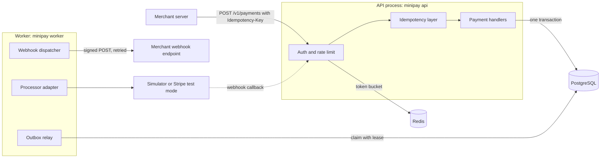
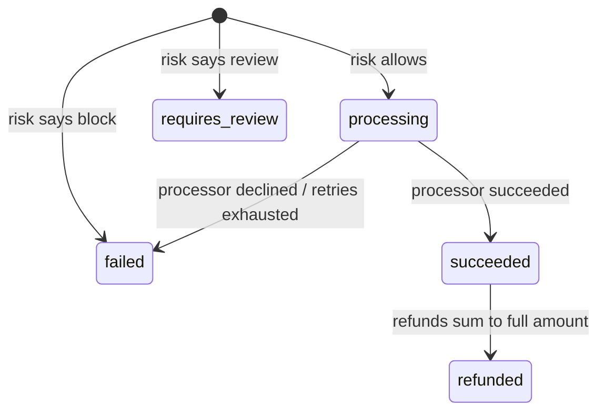

# Architecture

This document describes MiniPay's architecture. It is updated whenever the architecture changes.

## Component Diagram

## Payment State Machine

## Sequence Diagram: Create Payment to Webhook

(To be added in Phase 1 when the full flow is implemented.)

## Ledger Posting Example

(To be added in Phase 1 when the ledger is implemented.)

